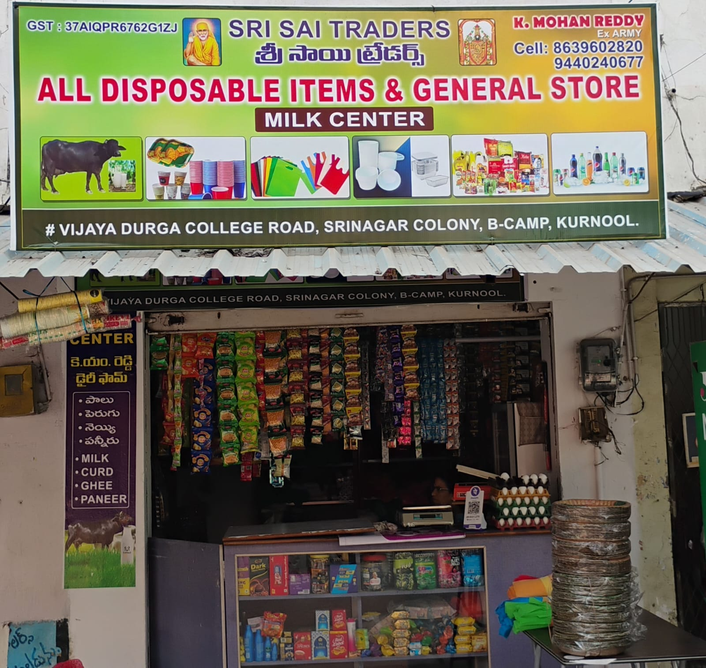

# 🏪 Sri Sai Traders — Premium Business Website

🌐 **Live Website:** https://srisaitraders-kurnool.netlify.app/

A modern, responsive, and visually appealing business website built for **Sri Sai Traders, Kurnool**.
Designed to showcase products, improve customer reach, and provide a smooth user experience.

---

## 🚀 Features

✨ Clean and modern UI
📱 Fully responsive (mobile + desktop)
⚡ Fast loading and optimized performance
🛒 Product showcase section
📍 Business information & contact details
🎯 Smooth animations and interactive design

---

## 🖼️ Preview



---

## 🛠️ Tech Stack

* **HTML5**
* **CSS3**
* **JavaScript**
* Responsive Design

---

## 📁 Project Structure

```
sri-sai-traders/
│── index.html        # Main website
│── style.css         # Styling
│── script.js         # Functionality
│── products.json     # Product data
│── assets/           # Images & media
```

---

## ⚙️ Installation & Usage

1. Clone the repository:

```bash
git clone https://github.com/kskreddy2k7/-Sri-Sai-Traders-website.git
```

2. Open folder:

```bash
cd -Sri-Sai-Traders-website
```

3. Run:

* Open `index.html` in browser

---

## 📌 Future Improvements

* 🛒 Add online ordering system
* 📦 Inventory management
* 📲 WhatsApp integration
* 🌐 SEO optimization

---

## 👨‍💻 Author

**Kata Sai Kranthu Reddy**
📧 [kskreddy2k7@gmail.com](mailto:kskreddy2k7@gmail.com)
🔗 GitHub: https://github.com/kskreddy2k7

---

## ⭐ Support

If you like this project:
👉 Give it a ⭐ on GitHub

---

## 📄 License

This project is for business and educational purposes.
